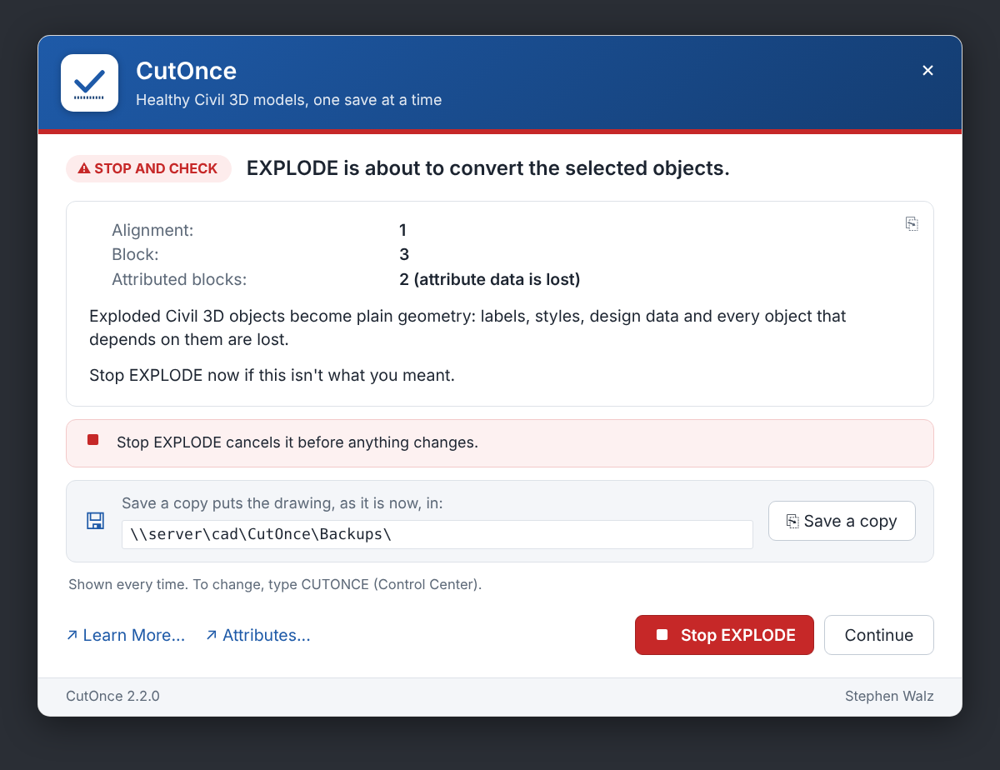
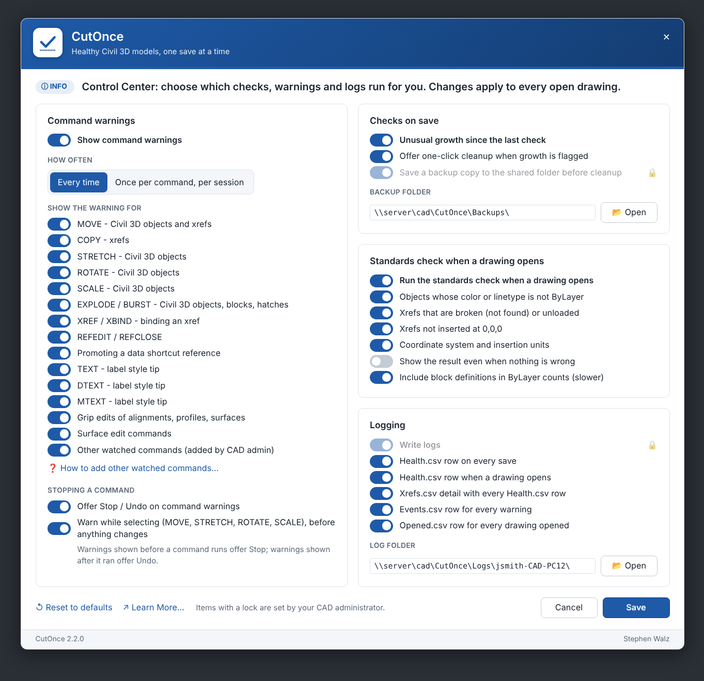

# CutOnce 2.2 for Civil 3D (.NET edition)

Publisher: Stephen Walz

CutOnce keeps Civil 3D models healthy while designers work. It does three things:

- **Guard.** Catches data-loss moves (EXPLODE, xref binds, moved xrefs) and shows what an edit will break, and now **stops the command** if the designer says so.
- **Learn.** Every warning explains why it matters and links to a knowledge-base article for that exact situation.
- **Insights.** Logs model health on every open and save, so teams can see trends across drawings, projects and people.

**New in 2.2 (.NET edition)**

- **Stop a command from its warning.** Warnings shown before a command runs have a red **Stop MOVE** (or EXPLODE, TEXT, REFEDIT...) button that cancels it before anything changes. Warnings shown after a command ran have **Undo EXPLODE**. MOVE, STRETCH, ROTATE and SCALE started with nothing selected now warn *while* Civil 3D objects are picked, with **Stop** and **Leave them out**.
- **Redesigned dialogs.** Every dialog shares one branded frame: a header in your brand colour with your logo, a severity badge and colour strip, styled text, switches in the Control Center, and a footer. Set your colour as `"#RRGGBB"` and your logo as a PNG.
- **EXPLODE warns before it runs** when the objects were selected first.
- **Xref detach is no longer reported as a bind.**
- Health.csv **Open** rows now include the Civil 3D style count and settings (no more `n/a`).
- One install package for **Civil 3D 2021 to 2026+**: the bundle loads the right DLL for each release.
- `CUTONCE-RELOADCONFIG` (apply config changes without restarting) and `CUTONCE-PREVIEW` (see a sample warning in your branding).

| A warning that can stop the command | The Control Center |
|---|---|
|  |  |

*Previews rendered from an HTML mock-up of the WPF layouts in `src/CutOnce.Civil3D/UI`; in Civil 3D the dialogs use Segoe UI and the Windows icon font.*

Everything else carries over from the LISP edition unchanged: command names, `CutOnce-Config.lsp` (read as-is), each designer's Control Center choices, log files and columns, Learn More links, backup copies.

| Folder | What is in it |
|---|---|
| `src/CutOnce.Core` | Everything that does not need AutoCAD: config reader, settings, logs, health and growth rules, standards report, dialog models. Builds and is tested on any PC |
| `src/CutOnce.Civil3D` | The Civil 3D plugin: events, the command gate (Stop), scanners, services, WPF dialogs, commands |
| `tests/CutOnce.Core.Tests` | 25 tests, no NuGet needed: `dotnet run --project tests/CutOnce.Core.Tests` |
| `bundle/CutOnce.bundle` | The autoloader manifest and the admin config |
| `build/` | `Build-Bundle.ps1` (build + package + zip) and the installer scripts |
| `docs/` | [Getting started in VS Code](docs/GETTING-STARTED.md), [How the LISP was converted](docs/CONVERSION-GUIDE.md), [CAD admin guide](docs/CAD-Admin-Guide.html) |

**Developers: start with [docs/GETTING-STARTED.md](docs/GETTING-STARTED.md).** It walks through opening the folder in VS Code, building, debugging inside Civil 3D, and producing the install zip.

---

## What runs

| Part | What it does | Interrupts the user? |
|---|---|---|
| **Standards check** | When a drawing opens: objects not ByLayer, xrefs broken or unloaded, xrefs not at 0,0,0, coordinate system and insertion units | Only when something is wrong (or always, if the designer chooses) |
| **Health log** | A Health.csv row (and Xrefs.csv detail) on every save and open | Never |
| **Guard** | EXPLODE / BURST, XREF bind, moving an xref, REFEDIT, promoting a data shortcut, TEXT tips. On save, unusual growth | Only when something risky happens, with Stop or Undo |
| **Cleanup** | Offered by the growth warning: PURGE, Purge Styles, scale list reset, AUDIT, after a backup copy | Only when the designer clicks Clean up now... |
| **Impact** | Before an alignment, surface or profile is edited, lists what depends on it | Grip edits, surface edits, MOVE / STRETCH / ROTATE / SCALE, with Stop |
| **Control Center** | One dialog to switch every item above on or off, per designer | Only when opened (`CUTONCE`) |

## Stopping a command

AutoLISP could only warn: designers clicked OK, then pressed ESC. The .NET edition hooks the moment a command takes the drawing, before it changes anything, and can veto it.

| Warning | When it shows | Buttons |
|---|---|---|
| Impact: objects selected first, grip edits, surface edits, watched commands | As the command starts | **Stop *command*** (nothing changes), Continue |
| Impact: MOVE / STRETCH / ROTATE / SCALE with nothing selected | As a Civil 3D object with dependents is picked | **Stop**, **Leave them out** (removes them from the selection and carries on), Continue |
| EXPLODE with the objects selected first | As EXPLODE starts | **Stop EXPLODE**, Continue |
| EXPLODE / BURST picked inside the command, XREF bind, xref moved or copied, impact found only at the end | After the command | **Undo *command*** (the same as typing U), Keep it |
| REFEDIT, REFCLOSE, promote reference, TEXT / DTEXT / MTEXT tip | As the command starts | **Stop *command***, Continue |
| Cleanup result | After cleanup | **Undo cleanup**, Save now, Close |

Every stop and undo is written to Events.csv (`COMMAND-STOPPED`, `COMMAND-UNDONE`, `SELECTION-FILTERED`). Enter (or ESC, or the close button) always means Continue, so muscle memory never stops a command by accident.

Switches (Control Center > Command warnings > Stopping a command): `WarnOfferStop` (show Stop / Undo at all) and `WarnWhileSelecting`. CAD admins: `("StopOnLock" . nil)` makes warnings show from the command-start event instead, as in the LISP edition, with Stop sending ESC.

## CutOnce Control Center

Type `CUTONCE`.

| Card | Switches |
|---|---|
| Command warnings | Master switch; every time or once per command per session; one switch per command (MOVE, COPY, STRETCH, ROTATE, SCALE, EXPLODE, XREF bind, REFEDIT, promote, TEXT, DTEXT, MTEXT, grips, surface edits, other watched commands); Stopping a command |
| Checks on save | Unusual growth, offer cleanup, backup before cleanup; backup folder with **Open** |
| Standards check when a drawing opens | Run on open, ByLayer, xref status, xref at 0,0,0, coordinate system / units, always show, include block definitions |
| Logging | Master switch, Health.csv on save / on open, Xrefs.csv, Events.csv, Opened.csv; log folder with **Open** |

- Choices are stored in the designer's AutoCAD profile (the same values as the LISP edition) and apply to every open drawing immediately.
- Turning a master switch off greys out the switches under it. Items the CAD administrator locked show a lock and say so.
- **Reset to defaults** returns to the firm's defaults from `CutOnce-Config.lsp`.

Command-line version for scripts and toolbar buttons: `-CUTONCE`. Type a setting name (or enough of it to be unique) to toggle it, or `List`, `Frequency`, `Warnings`, `Defaults`, `eXit`, e.g. `^C^C-CUTONCE;WarnEXPLODE;;`.

Setting names: `CommandWarnings`, `WarnMOVE`, `WarnCOPY`, `WarnSTRETCH`, `WarnROTATE`, `WarnSCALE`, `WarnEXPLODE`, `WarnXREFBIND`, `WarnREFEDIT`, `WarnPROMOTE`, `WarnTEXT`, `WarnDTEXT`, `WarnMTEXT`, `WarnGRIPS`, `WarnSURFACE`, `WarnOTHER`, `WarnOfferStop`, `WarnWhileSelecting`, `GuardGrowth`, `GuardCleanup`, `BackupBeforeCleanup`, `StdCheckOnOpen`, `StdByLayer`, `StdXrefStatus`, `StdXrefOrigin`, `StdCoordUnits`, `StdAlwaysShow`, `StdScanBlocks`, `LogEnabled`, `LogHealthOnSave`, `LogHealthOnOpen`, `LogXrefs`, `LogEvents`, `LogOpened`.

## Look and branding

Every dialog (warnings, growth, change impact, cleanup, the Control Center) shares one frame:

- **Header** in the brand colour (a soft gradient): a white logo tile, the name and tagline, and a close button. Drag the header to move the dialog.
- **Severity strip and badge** under the header: amber WARNING, red STOP AND CHECK, green ALL CLEAR, or the brand colour for INFO, next to a one-line headline.
- **Body** with headings, value rows and bullets styled from the message, a copy-text button, the Save a copy card and the Stop / Undo explanation.
- **Footer** with the name, version and publisher.

Set the brand in `CutOnce-Config.lsp`: `BrandName`, `BrandTagline`, `BrandColor` (`"#1E5AA8"`, or an AutoCAD colour number as before) and `BrandLogo` (a PNG or JPG; `CutOnce-Logo.png` in the install folder is used automatically). Without a logo the tile shows CutOnce's mark: a check above a dashed cut line. Type `CUTONCE-PREVIEW` to check the result.

## Logs

All files go to the log folder (see `CUTONCE-STATUS`). Same files, columns and rules as the LISP edition.

| File | One row per | Contents |
|---|---|---|
| `Health.csv` | check (Save, Open, Audit, Manual) | Who, when, trigger, drawing, counts, styles, ByLayer, xrefs, settings, plus any `HealthExtraCounts` columns |
| `Xrefs.csv` | xref, per Health.csv row | Name, path, Attach/Overlay, Loaded/Unloaded/Not Found, nested, instances, insertion point, rotation, scale, at 0,0,0, units, coordinate system |
| `Backups.csv` | backup copy | Who, when, computer, drawing, copy path, reason, unsaved changes left out. Written even with logging off |
| `Events.csv` | warning raised (also when frequency hides it) | Who, when, drawing, event type, detail |
| `Opened.csv` | drawing opened | Who, when, drawing |

**Event codes:** `IMPACT`, `STANDARDS-OPEN`, `EXPLODE-LOSS`, `ATTRIB-LOSS`, `XREF-BIND`, `XREF-MOVED`, `SAVE-FLAG`, `CLEANUP`, `BACKUP-COPY`, `ADVISORY-REFEDIT`, `ADVISORY-REFCLOSE`, `ADVISORY-PROMOTE`, `TEXT-TIP`, `TEXT-USED`, and new in 2.2: `COMMAND-STOPPED`, `COMMAND-UNDONE`, `SELECTION-FILTERED`.

Health.csv columns are unchanged, so no archive happens on upgrade. Two values are now computed by the .NET API rather than COM: `Styles` (counted from the Civil 3D style collections) and `AngularUnits` (a name such as `Degree` instead of a number). The first save after upgrading can therefore flag Styles growth once.

## Install

Requirements: Civil 3D 2021 or later, 64-bit Windows.

1. Close Civil 3D.
2. Unzip the release and double-click **Install.cmd**.
3. Start Civil 3D and type `CUTONCE-STATUS`, then `CUTONCE`.

This installs to `%APPDATA%\Autodesk\ApplicationPlugins\CutOnce.bundle`, which Civil 3D loads automatically and trusts by default, exactly like the LISP edition, and replaces it in place.

| Goal | Command |
|---|---|
| All users on the machine (run as administrator) | `Install.cmd -Scope AllUsers` |
| Choose the log folder | `Install.cmd -LogDir "D:\CAD\CutOnce\Logs"` |
| Shared team log folder, one subfolder per person | `Install.cmd -LogDir "\\server\cad\CutOnce\Logs" -LogSubfolder user-computer` |
| Change the log folder after installing | Double-click **Set-LogFolder.cmd** |
| Shared backup folder | `Install.cmd -BackupDir "\\server\cad\CutOnce\Backups"` |
| Custom install folder, such as a network share | `Install.cmd -InstallDir "\\server\cad\CutOnce"` (registers CutOnce to load at startup; add the folder to Trusted Locations) |

Reinstalling keeps an existing `CutOnce-Config.lsp` and writes the current version next to it as `CutOnce-Config.sample.lsp`.

## Configure (CAD administrators)

Step-by-step instructions are in `CAD-Admin-Guide.html`. `CutOnce-Config.lsp`, in the install folder's `Contents`, is plain text with a comment for every setting; the .NET edition reads it as data. Change it, then type `CUTONCE-RELOADCONFIG` (or restart).

- **Control Center defaults** and **LockedSettings**: as before, for every setting name above plus `WarnFrequency`.
- `ImpactExtraCommands`, `HealthExtraCounts`, `LogDir`, `LogSubfolder`, `BackupDir`, `ProjectStandards` / `CutOnce-Project.ini`, `CoordSysRequired`, `GuardGrowthWarnPct`, `LearnMoreUrl`, `LearnMoreAnchors`, `LearnMoreHighlight`: unchanged.
- New: `WarnOfferStop`, `WarnWhileSelecting`, `StopOnLock`, `BrandLogo`, `BrandColor` as `"#RRGGBB"`.

## Commands

| Command | Purpose |
|---|---|
| `CUTONCE` / `-CUTONCE` | Control Center / the same at the command line |
| `CUTONCE-STATUS` | Version, folders, config file, Civil 3D API, logging, Stop on/off |
| `CUTONCE-RELOADCONFIG` | Re-read `CutOnce-Config.lsp` without restarting |
| `CUTONCE-PREVIEW` | Show a sample warning, to check the branding |
| `CUTONCE-CHECK` / `CUTONCE-CHECK-STATUS` | Standards check now; its settings |
| `CUTONCE-AUDIT` / `CUTONCE-AUDIT-FOLDER` | Record every open drawing / every .dwg in a folder in Health.csv, open it in Excel |
| `CUTONCE-CLEANUP` | Cleanup dialog |
| `CUTONCE-BACKUP` / `CUTONCE-BACKUP-FOLDER` | Copy this drawing to the backup folder now; open that folder |
| `CUTONCE-GUARD-STATUS` / `-CHECKNOW` / `-SUMMARY` / `-LOG` | Guard switches, health check now, history rollup, log paths |
| `CUTONCE-GUARD-DUMPOBJECTS` | Counts of every object type by name |
| `CUTONCE-GUARD-LOGCOMMANDS` | Print every command name as it runs |
| `CUTONCE-IMPACT-ON` / `-OFF` / `-STATUS` / `-DEBUG` | Command warnings on/off, status, diagnostic messages |
| `CUTONCE-FINDCIVIL` | Kept for old buttons; reports the Civil 3D API connection |

## Known limitations

- Stop vetoes a command as it takes the drawing. A command that never takes it (rare) gets its warning while it waits for input, and Stop cancels it like ESC. Warnings shown after a command ran offer Undo instead.
- Surface edits started from Toolspace's right-click menu do not raise a command event, so they are not seen.
- Data shortcut references are not checked for broken sources. Use Prospector > Data Shortcuts.
- New, unsaved drawings are not checked or logged on open. Run `CUTONCE-CHECK` by hand.
- Pipe proximity uses bounding boxes, so treat it as "worth checking".
- An xref's coordinate system is read only when the xref is loaded and has a geographic location.
- Grading-group references to a surface are reported only on releases whose .NET API exposes them.
- Cleanup offered from the growth warning is queued to start after the save; if it does not start, type `CUTONCE-CLEANUP`.

## Uninstall

Double-click **Uninstall.cmd**. Add `-RemoveLogs` to delete logs as well. Each designer's Control Center choices are removed. Removes the LISP edition too.
